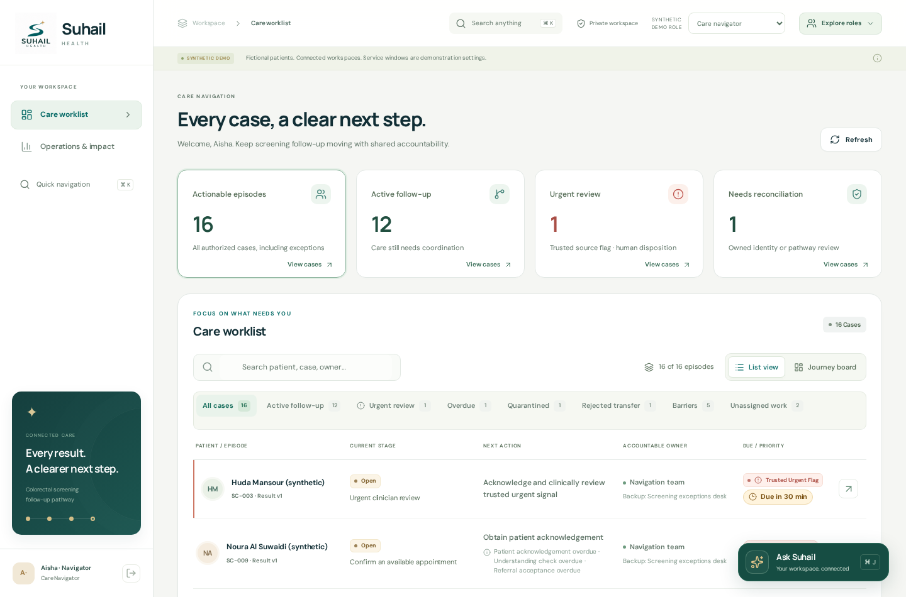
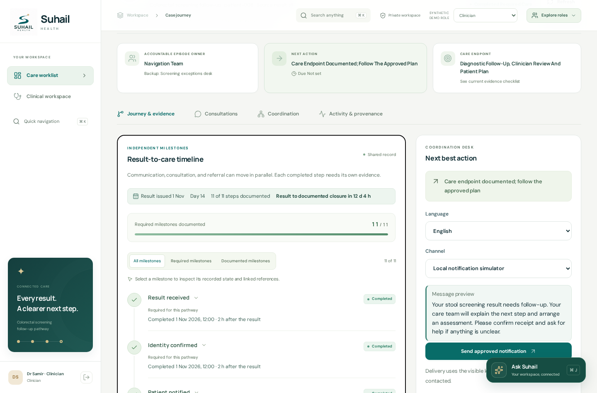
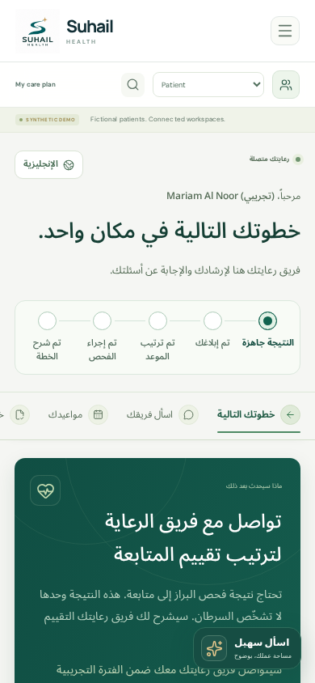
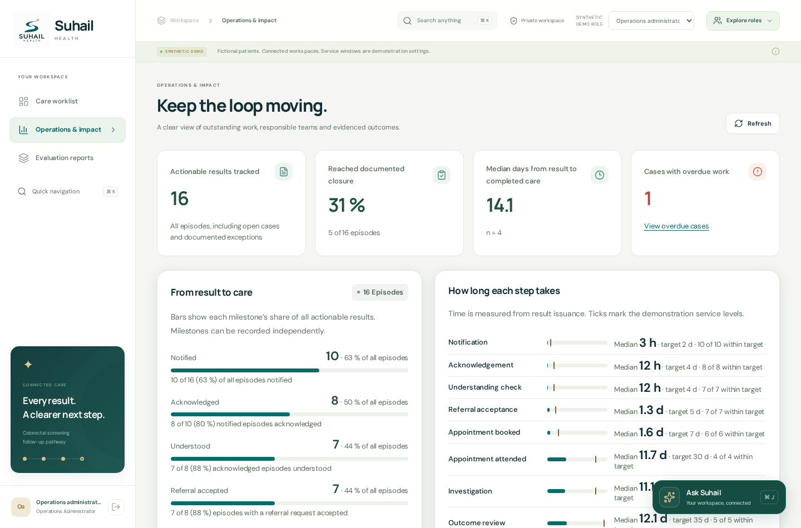
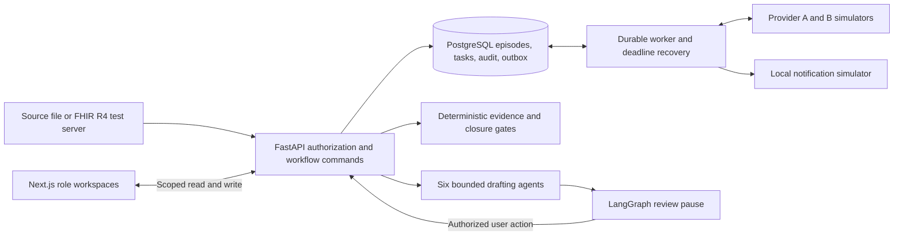

# Suhail Health
## Closing the Screening-to-Care Loop

**Future Health Digital Innovation Challenge · Population Health · Challenge 05 · Prototype**

Suhail Health gives screening programmes, clinics and receiving providers a shared record of what happens after an actionable screening result. Each episode has an owner, a deadline and a next step. Patients can read their care team's message in Arabic or English, confirm receipt and answer two questions about the plan. Staff can recover a missed handoff or appointment and follow the episode through to an evidenced clinical disposition. The prototype runs locally with fictional patients.

[Final prototype demo](reports/video-final/Suhail_Health_Final_Demo.mp4) · [Pitch deck](docs/Suhail_Health_Deck.pdf) · [Upload files and form copy](SUBMISSION_TODO_FOR_HUMAN.md)

## The problem

When a screening result moves from the lab to a clinic and on to a receiving service, responsibility can become unclear. In a US study of 32,769 people with a positive stool-based screening test, 56% completed a follow-up colonoscopy within one year. A separate retrospective study found that follow-up colonoscopy at 10–12 months was associated with higher odds of colorectal cancer and advanced-stage disease than follow-up at 8–30 days. These studies explain the follow-up gap and inform the simulation. [Mohl et al., 2023](https://jamanetwork.com/journals/jamanetworkopen/fullarticle/2800553) · [Corley et al., 2017](https://jamanetwork.com/journals/jama/fullarticle/2620087)

## The prototype

| Navigator worklist | Dated case journey |
|---|---|
|  |  |
| **Arabic patient workspace** | **Operations outcomes** |
|  |  |

## How Suhail meets each required outcome

| Challenge outcome | What works and where to see it | Verification |
|---|---|---|
| **1. End-to-end visibility** | Navigator or clinician, `/cases/SC-008`. Dated milestones cover intake, patient contact, referral, attendance, verified evidence and the recorded care endpoint. | [Full browser care journey](tests/test_browser_care.py) |
| **2. Ownership and timely progression** | Navigator, `/worklist` and the case Coordination tab. View owners, next actions, deadlines and recovery work. Staff can reassign tasks. Backup queues receive overdue routine work. | [Backend tests and timer checks](tests/test_backend.py) |
| **3. Patient-centered communication** | Patient, `/patient`. Read the original secure message, confirm receipt, answer the teach-back questions and ask for practical help. Uncertain answers create an assigned navigator task. | [Arabic, acknowledgement and teach-back browser coverage](tests/test_browser.py) |
| **4. Consultation and coordination** | Clinician or specialist, `/clinical`. Receiving service, `/receiving`. Human replies record agreed next actions. Receiving services decide explicitly and return source evidence through a scoped referral packet. | [Integration tests](tests/test_integrations_live.py) · [Browser care journey](tests/test_browser_care.py) |
| **5. Human-governed escalation** | Clinician, `/cases/SC-003` and `/cases/SC-007`. A trusted urgent flag goes directly to staff, with a separate acknowledgement and disposition. The closure checklist requires verified evidence and clinician authorization. | [Frozen offline evidence](reports/runs/20261120T135507Z-offline/software_suite.json) |
| **6. Closure and patient impact** | Navigator or operations administrator, `/operations`. Timing distributions, referral and attendance rates, unresolved work, dispositions and patient understanding retain explicit denominators. | [Metrics and endpoint tests](tests/test_backend.py) · [Simulated cohort results](reports/impact/impact-summary.json) |

## Impact and how we would measure it

In the **simulated cohort**, year-one follow-up rises from **56% to 69%** under the stated assumptions. This represents **1,300 additional completions per 10,000 actionable results**, with a modelled range of **650 to 1,940**. The simulation uses US follow-up rates and transfers the effect observed in a patient-navigation trial to a software-supported workflow. Its 360-day Suhail scenario range is **62.5% to 75.4%**. [Simulation method, sources and limits](docs/IMPACT_MODEL.md) · [Machine-readable results](reports/impact/impact-summary.json)

Operational evidence comes from a separate synthetic software evaluation. All **1,000 journey checks** and **500 attempts to close care prematurely** passed their expected-state checks. The proposed **12-week pilot** would replace the simulation assumptions with local observations on one pathway and measure whether follow-up, patient understanding and documented closure improve. [Frozen-code verification](reports/runs/20261120T135507Z-offline/summary.html) · [Pilot plan](docs/PILOT_PLAN.md)

## Architecture



The application uses Next.js and TypeScript, FastAPI with Pydantic and SQLAlchemy, PostgreSQL, a persistent worker/outbox, Docker Compose and LangGraph review checkpoints. Versioned pathway rules govern evidence and operational windows. The FHIR R4 test server and receiving providers are synthetic integrations. [Architecture](docs/ARCHITECTURE.md) · [Canonical contracts](contracts/README.md)

## Responsible AI and data governance

Six bounded functions prepare source-linked drafts. The application validates tool arguments, evidence and permissions. An authorized clinician records clinical dispositions. Trusted-source urgent routing uses deterministic rules and a backup queue, independent of inference. Model-bound patient names and IDs use stable, organization-scoped tokens. Optional inference uses tool and citation allowlists, request and token budgets, and a hash-chained call ledger.

The demo holds project-generated synthetic records. The patient workspace is limited to the signed-in patient's case. Receiving services see the minimum granted referral packet. Audit events retain the actor, source, state version and reason for decisions. [Model card](docs/MODEL_CARD.md) · [Data card](docs/DATA_CARD.md)

## Assumptions, dependencies and limitations

- The prototype starts with an actionable colorectal FIT result. Clinical teams decide the investigation, treatment or surveillance plan. Service clocks are demonstration settings. A pilot host must approve the pathway, service levels, clinical text and Arabic translations.
- The native run uses Python 3.13, Node.js 22 and PostgreSQL 17. The core workflow runs without a Groq key. Optional model drafting requires the operator's private configuration. Docker Compose packages the local services. [Deployment](docs/DEPLOYMENT.md)
- Notifications and provider services are simulated. The test FHIR interface demonstrates scoped, version-aware intake. Institutional identity, real EHR integration, exchange access, clinical sign-off and deployment approval remain pilot prerequisites. Malaffi, NABIDH and Riayati are possible future integration routes.
- One demonstration pathway is configured. Independent clinical and Arabic reviews and studies with patients or volunteers remain outstanding. The impact figures are simulated under declared assumptions. The pilot would collect a local baseline, measure workflow outcomes and report missing follow-up.
- The earlier partial Groq run had five scored standalone examples per function. Rates and scoring audits apply to the recorded sample. The adapted public HealthBench subset is exploratory and has incomplete execution. Optional Synthea and MedAgentBench were not run, and credentialed MIMIC is excluded. [Evaluation status](docs/EVAL_STATUS.md) · [Source and data declarations](docs/SOURCES.md) · [Connector capabilities](docs/CONNECTOR_CAPABILITIES.csv)

## Verification and how to run

The frozen Product release passed **139 automated tests** with two opt-in tests skipped, the production build, **16 Chromium browser tests**, and smoke checks for all seven demo roles. The independent offline run passed **1,500 of 1,500** checks. [Verification summary](reports/verification/summary.md) · [Final offline report](reports/runs/20261120T135507Z-offline/summary.html)

```bash
make setup
make build
make up
```

Open `http://127.0.0.1:3000` and choose **Enter synthetic demo**. The operations administrator can read the outcomes and evaluation pages. See [README](README.md) for additional setup and test commands.
