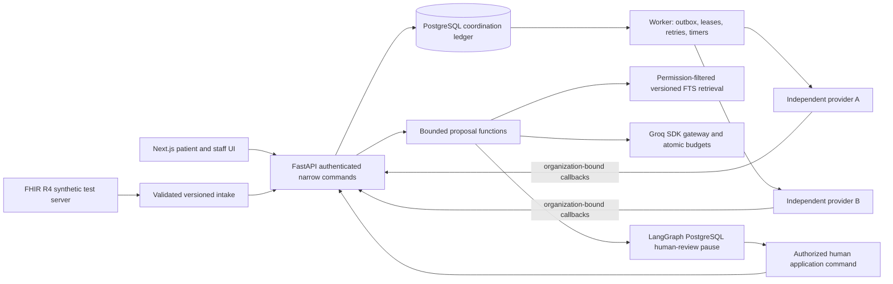

# Architecture and authority

The database stores canonical records individually: cases, tasks, milestones, handoffs, grants, communications, consultations, appointments, evidence, retained source artifacts, escalations, dispositions, patient experience responses, audit/access decisions, source events, command receipts, outbox, users and sessions. Rows are not an LLM transcript.

PostgreSQL row/advisory locks serialize case commands and duplicate source intake. Every mutation checks authenticated role/organization/patient scope, expected case version and idempotency. State, audit and outbox commit together. Persistent worker leases and deadlines allow replay after restart. Independent providers persist their own receipts/callbacks and hold a minimal referral packet only. Ownership acceptance and access grants remain separate.

Groq schema requests have no tools or streaming. Tool requests use separate prompts and a sequential local allowlist. Local tool execution rechecks case scope/version and role. Trusted urgent routing, evidence validity, deadlines and closure operate without inference or retrieval availability. The graph interrupt stores source-linked proposals awaiting a human; resuming a proposal records review without changing clinical state. Clinical disposition requires a separate transaction with fresh checks.

Retrieval indexes only prefiltered permitted current sections in SQLite FTS5. Source metadata includes authority, jurisdiction, effective/expiry dates, version, language, scope and exact section citation. No vector database is necessary for this small pack. Missing, conflicting, expired or injected documents require owned review; they cannot introduce a clinical rule.

Provider/FHIR services are explicitly simulated integrations. No live EHR or UAE exchange credentials are configured. The interface exposes failure/retry/blocked states and measured report records rather than a fabricated leaderboard.
